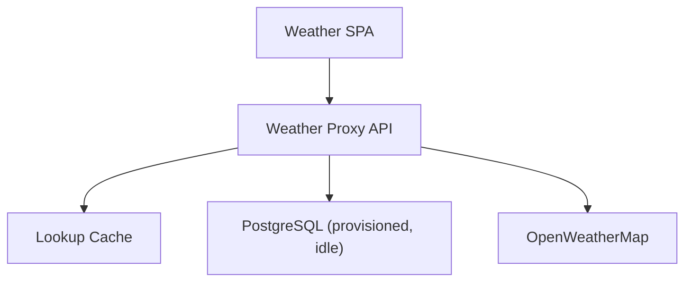
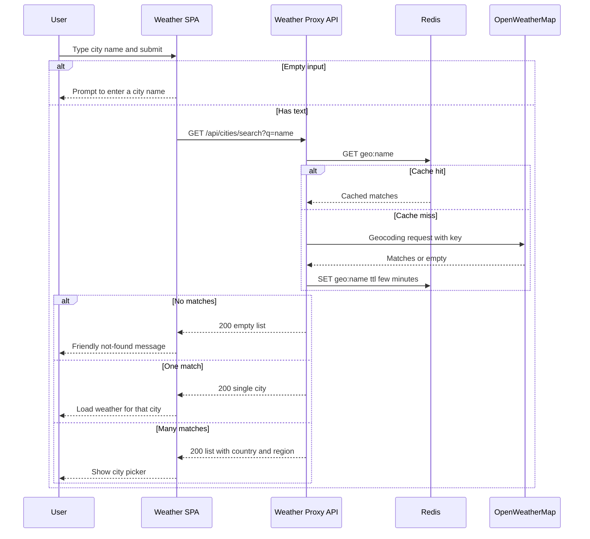
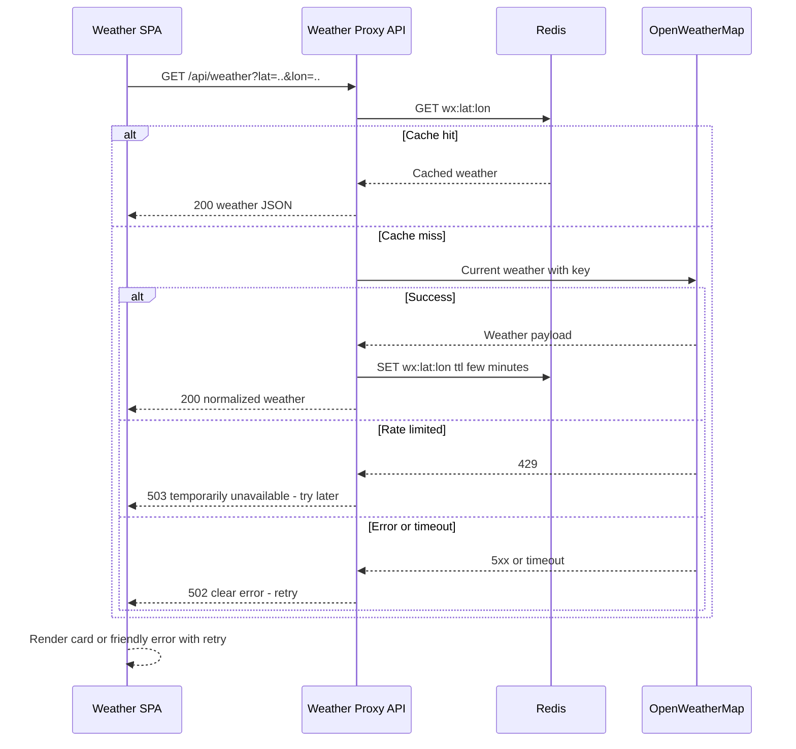
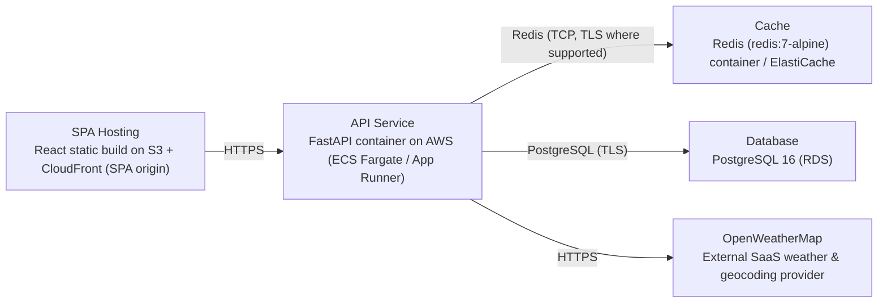

# Architecture

> Maintained by QuorQ AI SDLC. Text between `sdlc:auto` markers is regenerated; anything outside them is yours and is kept.

<!-- sdlc:auto:start narrative -->
## Overview

### ARCH-001 · approved · source: architecture:summary

Overall architecture is a lightweight, no-accounts public weather app: a React SPA talks to a thin FastAPI backend that proxies OpenWeatherMap, with Redis caching for speed and rate-limit protection. PostgreSQL is provisioned but unused in this scope. Hosted on AWS.

Approved, version 1. A React 19 single-page app (own origin) provides a search box, a city-disambiguation picker, a current-weather card (humidity/wind/feels-like), and an instant Celsius/Fahrenheit toggle. It calls a separate-origin FastAPI 0.115 backend that keeps the OpenWeatherMap API key server-side, geocodes city names, fetches current weather, caches recent lookups in Redis for a few minutes (speed + provider rate-limit protection), and returns clean JSON with friendly not-found and error handling. PostgreSQL 16 is provisioned per the approved stack but idle in this scope since no visitor data is stored. Deployed on AWS.

### ARCH-002 · approved · source: architecture:component:frontend

Weather SPA (React 19): the single-screen client app covering search, disambiguation, weather display, and unit toggling.

Single-screen React app comprising: search box; city-picker shown for ambiguous city names; current-weather card; instant Celsius/Fahrenheit toggle with client-side conversion and unit remembered for the session; loading indicator; friendly not-found and error states. Responsive layout for mobile and desktop. Reads backend location from the VITE_API_BASE_URL environment variable.

### ARCH-003 · approved · source: architecture:component:api

Weather Proxy API (FastAPI 0.115): thin backend between the browser and OpenWeatherMap that hides the provider API key and normalizes responses/errors.

Keeps WEATHER_API_KEY server-side (never exposed to the browser). Exposes city-search (geocoding/disambiguation) and current-weather endpoints. Caches lookups in Redis. Maps provider errors, timeouts, and rate-limit responses to clear, non-technical JSON error messages. Returns clean JSON to the SPA.

### ARCH-004 · approved · source: architecture:component:cache

Lookup Cache (Redis 7, redis:7-alpine): short-TTL cache of recent geocoding and weather lookups.

Caches recent geocoding and current-weather responses keyed by query/coordinates for a short TTL (a few minutes). Purpose: keep the app fast for popular cities and stay within the OpenWeatherMap provider's request/rate limits. Checked before any call to the external provider.

### ARCH-005 · approved · source: architecture:component:database

PostgreSQL 16 is provisioned as the approved default stack database but is idle in this scope -- no application tables, no visitor data stored.

Provisioned as the safe default should remembered searches or logging be added later. Consistent with the no-accounts/no-personal-data design of this release, it currently holds no application tables and performs no function in the current critical paths.

### ARCH-006 · approved · source: architecture:component:weather_provider

OpenWeatherMap is the external REST provider supplying city geocoding (for search/disambiguation) and current weather data.

Supplies: city geocoding for search/disambiguation, and current weather (temperature, condition, icon, humidity, wind, feels-like). Authenticated via WEATHER_API_KEY, which is held only on the backend per ARCH-003.

### ARCH-007 · approved · source: architecture:critical_path:city_search_and_disambiguation

Critical path for searching a city name and resolving it to a specific location, including disambiguation when multiple matches exist.

User submits a city name. Empty input is rejected client-side before any API call. The API geocodes the name via OpenWeatherMap, checking the cache first. Zero matches return a friendly not-found message. Exactly one match flows straight through to the weather view. Multiple matches return a list of candidates with country and region/state so the user can disambiguate.

### ARCH-008 · approved · source: architecture:critical_path:current_weather_retrieval

Critical path for fetching current weather for a chosen city, with caching and resilient error handling.

For a selected city (identified by coordinates), the API returns current weather. The cache is checked first; on a cache miss, it calls OpenWeatherMap. Timeouts, errors, and rate-limit responses from the provider are mapped to clear, non-technical messages the SPA can display along with a retry option. Any detail values missing from the provider are marked unavailable rather than left blank.

### ARCH-009 · approved · source: architecture:endpoints

Three API endpoints: city search/geocoding, current weather, and a health check.

GET /api/cities/search -- geocodes a city name and returns matching cities with country and region/state for disambiguation; empty/whitespace query returns 422 so the SPA prompts for input; zero matches returns an empty list (SPA shows friendly not-found). GET /api/weather -- returns current weather for a selected city by coordinates: city name, temperature in Celsius, condition text and icon, humidity, wind, and feels-like; values absent from the provider are marked unavailable. GET /api/health -- liveness/readiness check used for deployment and monitoring.

### ARCH-010 · approved · source: architecture:deployment_nodes

Deployment topology on AWS: static SPA on S3/CloudFront, containerized API on ECS Fargate/App Runner, Redis cache, idle RDS PostgreSQL, and the external OpenWeatherMap provider.

SPA Hosting: React static build served via S3 + CloudFront (SPA origin, static assets on CDN). API Service: FastAPI container on AWS (ECS Fargate / App Runner), Python 3.12, FastAPI 0.115 + uvicorn. Cache: Redis (redis:7-alpine) container / ElastiCache, Redis 7. Database: PostgreSQL 16 on RDS (provisioned, idle). OpenWeatherMap: external SaaS weather & geocoding provider reached over HTTPS REST.

### ARCH-011 · approved · source: architecture:technology_decision:frontend

Frontend technology chosen: React 19 (over Vue, Svelte).

Rationale: the whole product is one interactive screen -- search, city-picker, weather card, and an instant C/F toggle. React 19 handles type-ahead and live client-side unit conversion with no reload, and makes the responsive mobile/desktop layout straightforward. Built as a Vite SPA served from its own origin, reading VITE_API_BASE_URL. Alternatives considered: Vue, Svelte.

### ARCH-012 · approved · source: architecture:technology_decision:backend

Backend technology chosen: FastAPI 0.115 (over Express, Flask).

Rationale: a thin proxy is needed to keep WEATHER_API_KEY off the browser and to forward geocoding and weather calls as clean JSON. FastAPI 0.115 is lightweight, async-friendly for calling an external API, and quick to build this small surface in. Alternatives considered: Express, Flask.

### ARCH-013 · approved · source: architecture:technology_decision:database

Database technology chosen: PostgreSQL 16, provisioned but unused for now (alternatives: none/stateless, SQLite).

Rationale: provisioned as the approved safe default should remembered searches or logging be added later. In this scope it stores nothing and sits idle, consistent with the no-accounts/no-personal-data design. Alternatives considered: None (stateless), SQLite.

### ARCH-014 · approved · source: architecture:technology_decision:cloud

Cloud platform chosen: AWS (over GCP, Azure).

Rationale: a free public weather page needs globally reachable hosting that scales down when quiet and absorbs spikes without managing servers. AWS (CloudFront/S3 for the SPA, a scale-to-near-zero container for the API, ElastiCache/RDS) covers this and is the platform default. Alternatives considered: GCP, Azure.
<!-- sdlc:auto:end narrative -->

<!-- sdlc:auto:start building-blocks -->
## Building Block View

| ID | Name | Technology | Responsibility | Depends on |
|---|---|---|---|---|
| frontend | Weather SPA | React 19 | Single-screen React app: search box, city-picker for ambiguous names, current-weather card, instant C/F toggle (client-side conversion, unit remembered for the session), loading indicator, and friendly not-found/error states. Responsive mobile and desktop layout. Reads the API base URL from VITE_API_BASE_URL. | api |
| api | Weather Proxy API | FastAPI 0.115 | Thin backend between browser and OpenWeatherMap. Keeps WEATHER_API_KEY server-side, exposes city-search (geocoding/disambiguation) and current-weather endpoints, caches lookups in Redis, maps provider errors/timeouts/rate-limits to clear non-technical JSON, and returns clean JSON. | cache, database, weather_provider |
| cache | Lookup Cache | Redis 7 (redis:7-alpine) | Short-TTL cache of recent geocoding and current-weather responses keyed by query/coordinates, to keep the app fast for popular cities and stay within the provider's request limits. | — |
| database | PostgreSQL (provisioned, idle) | PostgreSQL 16 | Provisioned per the approved stack as the safe default if remembered searches or logging are added later. In this scope no visitor data is stored, so it holds no application tables. | — |
| weather_provider | OpenWeatherMap | OpenWeatherMap REST API | External provider supplying city geocoding for search/disambiguation and current weather (temperature, condition, icon, humidity, wind, feels-like). Authenticated with WEATHER_API_KEY. | — |

<!-- sdlc:auto:end building-blocks -->

<!-- sdlc:auto:start runtime -->
## Runtime View

### City search and disambiguation

User submits a city name; the API geocodes it via OpenWeatherMap (cache first). Empty input is rejected client-side. Zero matches return a friendly not-found; one match flows straight to weather; multiple matches return a list with country and region/state to disambiguate.

- **Components:** frontend, api, cache, weather_provider
- **Modules:** search_box, city_picker, routers/cities, services/geocoding, clients/owm, cache/redis_client
- **Key functions:** searchCities(query), GET /api/cities/search, geocode_city(query), cache_get(key), cache_set(key, value, ttl)

### Current weather retrieval with caching and resilience

For a selected city (by coordinates) the API returns current weather. Cache is checked first; on miss it calls OpenWeatherMap. Timeouts, errors and rate-limit responses are mapped to clear, non-technical messages the SPA can show with a retry. Missing detail values are marked unavailable rather than blank.

- **Components:** frontend, api, cache, weather_provider
- **Modules:** weather_card, routers/weather, services/weather, clients/owm, cache/redis_client, errors/handlers
- **Key functions:** fetchWeather(lat, lon), GET /api/weather, get_current_weather(lat, lon), map_provider_error(status), normalize_weather(payload)

<!-- sdlc:auto:end runtime -->

<!-- sdlc:auto:start deployment-view -->
## Deployment View

| Name | Service | Runtime | Scaling | Environment |
|---|---|---|---|---|
| SPA Hosting | React static build on S3 + CloudFront (SPA origin) | Static assets (CDN) | CDN edge caching, scales to global demand automatically | dev |
| API Service | FastAPI container on AWS (ECS Fargate / App Runner) | Python 3.12, FastAPI 0.115 + uvicorn | Scale to near-zero when idle, scale out on traffic spikes | dev |
| Cache | Redis (redis:7-alpine) container / ElastiCache | Redis 7 | Single small node sufficient for lightweight scope | dev |
| Database | PostgreSQL 16 (RDS) | PostgreSQL 16 | Smallest instance, idle in this scope | dev |
| OpenWeatherMap | External SaaS weather & geocoding provider | HTTPS REST | Managed by provider (rate-limited) | dev |

| Source | Target | Protocol |
|---|---|---|
| SPA Hosting | API Service | HTTPS |
| API Service | Cache | Redis (TCP, TLS where supported) |
| API Service | Database | PostgreSQL (TLS) |
| API Service | OpenWeatherMap | HTTPS |

<!-- sdlc:auto:end deployment-view -->

<!-- sdlc:auto:start decisions -->
## Architecture Decisions

| Layer | Choice | ADR |
|---|---|---|
| Frontend | React 19 | [ADR-0001](adr/frontend.md) |
| Backend | FastAPI 0.115 | [ADR-0002](adr/backend.md) |
| Database | PostgreSQL 16 | [ADR-0003](adr/database.md) |
| Cloud | AWS | [ADR-0004](adr/cloud.md) |
<!-- sdlc:auto:end decisions -->

<!-- sdlc:auto:start links -->
## Related Documents

- [Data Model](data-model.md)
- [API Specification](api/openapi.yaml)
- [Architecture Decision Records](adr/README.md)
<!-- sdlc:auto:end links -->
