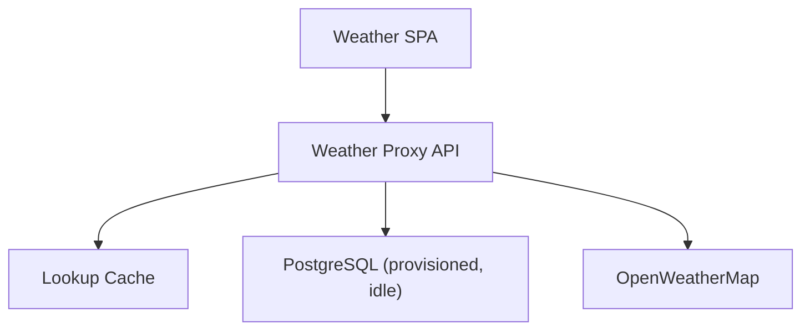
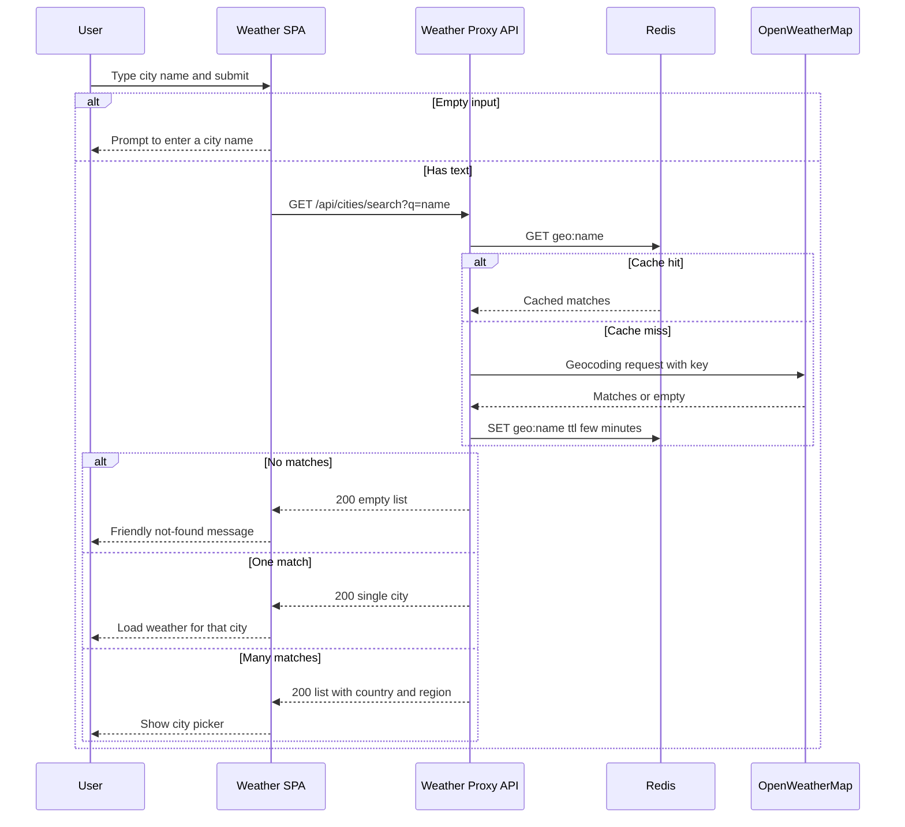
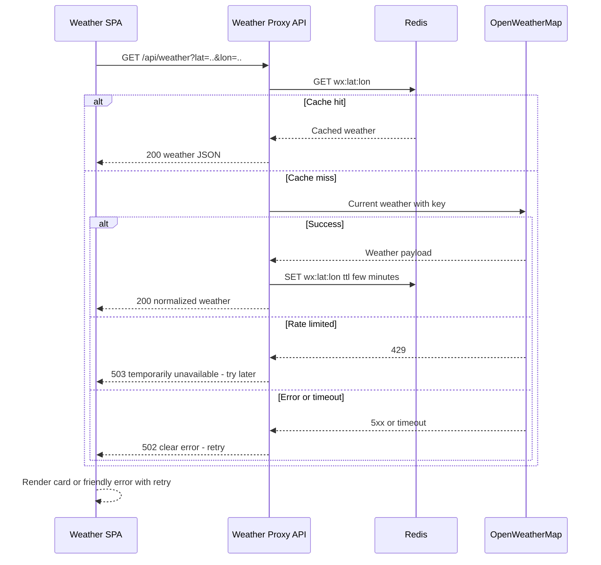
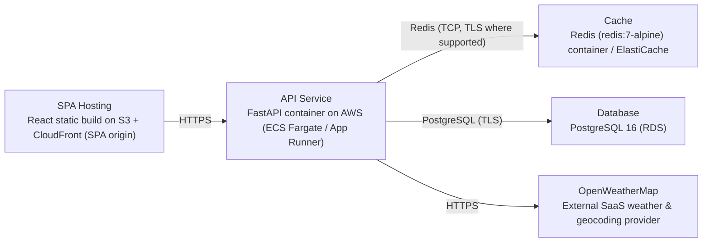

# Architecture

> Maintained by QuorQ AI SDLC. Text between `sdlc:auto` markers is regenerated; anything outside them is yours and is kept.

<!-- sdlc:auto:start narrative -->
## Overview

### ARCH-summary · approved · source: architecture:summary

Lightweight public weather app, no accounts: React 19 SPA talks to a thin FastAPI backend that keeps the OpenWeatherMap key server-side, geocodes cities, fetches weather, and caches lookups in Redis.

SPA and API are on separate origins. PostgreSQL 16 is provisioned per the approved stack but idle since nothing about visitors is stored. Deployed on AWS.

**Related:** REQ-STACK, REQ-SERVICES

### ARCH-frontend · approved · source: architecture:component:frontend

Weather SPA (React 19): the single screen covering search, disambiguation, weather display and unit toggle.

Search box, city-picker for ambiguous names, current-weather card, instant client-side C/F toggle (unit remembered for the session), loading indicator, friendly not-found/error states. Responsive mobile/desktop layout. Reads API base URL from VITE_API_BASE_URL.

**Related:** US-001, US-002, US-004, US-005, US-007, US-008

### ARCH-api · approved · source: architecture:component:api

Weather Proxy API (FastAPI 0.115): thin backend between browser and OpenWeatherMap.

Keeps WEATHER_API_KEY server-side; exposes city-search (geocoding/disambiguation) and current-weather endpoints; caches lookups in Redis; maps provider errors/timeouts/rate-limits to clear non-technical JSON; returns clean JSON.

**Related:** US-003, US-010, US-011, NFR-001, NFR-004

### ARCH-cache · approved · source: architecture:component:cache

Lookup Cache (Redis 7, redis:7-alpine): short-TTL cache of recent geocoding and weather responses.

Keyed by query/coordinates, keeps the app fast for popular cities and keeps calls within the provider's request limits.

**Related:** NFR-004, US-010, US-011

### ARCH-database · approved · source: architecture:component:database

PostgreSQL 16, provisioned but idle in this scope.

Safe default per the approved stack if remembered searches or logging are added later; no visitor data stored, so it holds no application tables currently.

**Related:** NFR-002

### ARCH-weather_provider · approved · source: architecture:component:weather_provider

OpenWeatherMap REST API: external provider for geocoding and current weather.

Supplies city geocoding for search/disambiguation and current weather (temperature, condition, icon, humidity, wind, feels-like). Authenticated with WEATHER_API_KEY.

**Related:** US-010, US-011, NFR-001

### ARCH-path-search · approved · source: architecture:critical_path:city-search

City search and disambiguation critical path.

User submits a city name; empty input rejected client-side; API geocodes via OpenWeatherMap (cache checked first). Zero matches -> friendly not-found. One match -> flows straight to weather. Multiple matches -> list with country and region/state to disambiguate.

**Related:** US-001, US-002, US-003

### ARCH-path-weather · approved · source: architecture:critical_path:current-weather

Current weather retrieval with caching and resilience.

For a selected city (by coordinates), API checks cache first, calls OpenWeatherMap on a miss. Timeouts, errors and rate-limit responses map to clear, non-technical messages the SPA shows with a retry. Missing detail values are marked unavailable rather than blank.

**Related:** US-004, US-005, US-011

### ARCH-endpoint-search · approved · source: architecture:endpoint:/api/cities/search

GET /api/cities/search -- geocodes a city name into disambiguation candidates.

Returns matching cities with country and region/state. Empty/whitespace query returns 422 (SPA prompts for input). Zero matches returns an empty list (SPA shows friendly not-found).

**Related:** US-001, US-002, US-003

### ARCH-endpoint-weather · approved · source: architecture:endpoint:/api/weather

GET /api/weather -- returns current weather for a selected city by coordinates.

Returns city name, temperature (Celsius), condition text and icon, humidity, wind and feels-like. Values absent from the provider are marked unavailable.

**Related:** US-004, US-005

### ARCH-endpoint-health · approved · source: architecture:endpoint:/api/health

GET /api/health -- liveness/readiness check for deployment and monitoring.

Used by deployment and monitoring tooling to confirm the API service is up.

### ARCH-deployment · approved · source: architecture:deployment_nodes

Planned AWS deployment topology for the SPA, API, cache, database and external provider.

- SPA Hosting: React static build on S3 + CloudFront (SPA origin), static assets on CDN.
- API Service: FastAPI container on AWS (ECS Fargate / App Runner), Python 3.12, FastAPI 0.115 + uvicorn.
- Cache: Redis (redis:7-alpine) container / ElastiCache, Redis 7.
- Database: PostgreSQL 16 (RDS).
- OpenWeatherMap: external SaaS weather & geocoding provider over HTTPS REST.

**Related:** ARCH-frontend, ARCH-api, ARCH-cache, ARCH-database, ARCH-weather_provider

### ARCH-tech-frontend · approved · source: architecture:technology_decision:frontend

React 19 chosen over Vue/Svelte for the frontend.

The whole product is one interactive screen -- search, city-picker, weather card and instant C/F toggle. React 19 handles type-ahead and live client-side unit conversion with no reload, and supports the responsive mobile/desktop layout. Built as a Vite SPA served from its own origin, reading VITE_API_BASE_URL.

**Related:** REQ-STACK

### ARCH-tech-backend · approved · source: architecture:technology_decision:backend

FastAPI 0.115 chosen over Express/Flask for the backend.

A thin proxy is needed to keep WEATHER_API_KEY off the browser and forward geocoding/weather calls as clean JSON. FastAPI 0.115 is lightweight, async-friendly for calling an external API, and quick to build this small surface in.

**Related:** REQ-STACK

### ARCH-tech-database · approved · source: architecture:technology_decision:database

PostgreSQL 16 chosen over stateless/SQLite as the provisioned default.

Provisioned as the approved safe default should remembered searches or logging be added later. In this scope it stores nothing and sits idle, consistent with no-accounts/no-personal-data.

**Related:** REQ-STACK

### ARCH-tech-cloud · approved · source: architecture:technology_decision:cloud

AWS chosen over GCP/Azure as the hosting platform.

A free public weather page needs globally reachable hosting that scales down when quiet and absorbs spikes without managing servers. AWS (CloudFront/S3 for the SPA, a scale-to-near-zero container for the API, ElastiCache/RDS) covers this and is the platform default.

**Related:** REQ-STACK
<!-- sdlc:auto:end narrative -->

<!-- sdlc:auto:start building-blocks -->
## Building Block View

| ID | Name | Technology | Responsibility | Depends on |
|---|---|---|---|---|
| frontend | Weather SPA | React 19 | Single-screen React app: search box, city-picker for ambiguous names, current-weather card, instant C/F toggle (client-side conversion, unit remembered for the session), loading indicator, and friendly not-found/error states. Responsive mobile and desktop layout. Reads the API base URL from VITE_API_BASE_URL. | api |
| api | Weather Proxy API | FastAPI 0.115 | Thin backend between browser and OpenWeatherMap. Keeps WEATHER_API_KEY server-side, exposes city-search (geocoding/disambiguation) and current-weather endpoints, caches lookups in Redis, maps provider errors/timeouts/rate-limits to clear non-technical JSON, and returns clean JSON. | cache, database, weather_provider |
| cache | Lookup Cache | Redis 7 (redis:7-alpine) | Short-TTL cache of recent geocoding and current-weather responses keyed by query/coordinates, to keep the app fast for popular cities and stay within the provider's request limits. | — |
| database | PostgreSQL (provisioned, idle) | PostgreSQL 16 | Provisioned per the approved stack as the safe default if remembered searches or logging are added later. In this scope no visitor data is stored, so it holds no application tables. | — |
| weather_provider | OpenWeatherMap | OpenWeatherMap REST API | External provider supplying city geocoding for search/disambiguation and current weather (temperature, condition, icon, humidity, wind, feels-like). Authenticated with WEATHER_API_KEY. | — |

<!-- sdlc:auto:end building-blocks -->

<!-- sdlc:auto:start runtime -->
## Runtime View

### City search and disambiguation

User submits a city name; the API geocodes it via OpenWeatherMap (cache first). Empty input is rejected client-side. Zero matches return a friendly not-found; one match flows straight to weather; multiple matches return a list with country and region/state to disambiguate.

- **Components:** frontend, api, cache, weather_provider
- **Modules:** search_box, city_picker, routers/cities, services/geocoding, clients/owm, cache/redis_client
- **Key functions:** searchCities(query), GET /api/cities/search, geocode_city(query), cache_get(key), cache_set(key, value, ttl)

### Current weather retrieval with caching and resilience

For a selected city (by coordinates) the API returns current weather. Cache is checked first; on miss it calls OpenWeatherMap. Timeouts, errors and rate-limit responses are mapped to clear, non-technical messages the SPA can show with a retry. Missing detail values are marked unavailable rather than blank.

- **Components:** frontend, api, cache, weather_provider
- **Modules:** weather_card, routers/weather, services/weather, clients/owm, cache/redis_client, errors/handlers
- **Key functions:** fetchWeather(lat, lon), GET /api/weather, get_current_weather(lat, lon), map_provider_error(status), normalize_weather(payload)

<!-- sdlc:auto:end runtime -->

<!-- sdlc:auto:start deployment-view -->
## Deployment View

| Name | Service | Runtime | Scaling | Environment |
|---|---|---|---|---|
| SPA Hosting | React static build on S3 + CloudFront (SPA origin) | Static assets (CDN) | CDN edge caching, scales to global demand automatically | dev |
| API Service | FastAPI container on AWS (ECS Fargate / App Runner) | Python 3.12, FastAPI 0.115 + uvicorn | Scale to near-zero when idle, scale out on traffic spikes | dev |
| Cache | Redis (redis:7-alpine) container / ElastiCache | Redis 7 | Single small node sufficient for lightweight scope | dev |
| Database | PostgreSQL 16 (RDS) | PostgreSQL 16 | Smallest instance, idle in this scope | dev |
| OpenWeatherMap | External SaaS weather & geocoding provider | HTTPS REST | Managed by provider (rate-limited) | dev |

| Source | Target | Protocol |
|---|---|---|
| SPA Hosting | API Service | HTTPS |
| API Service | Cache | Redis (TCP, TLS where supported) |
| API Service | Database | PostgreSQL (TLS) |
| API Service | OpenWeatherMap | HTTPS |

<!-- sdlc:auto:end deployment-view -->

<!-- sdlc:auto:start decisions -->
## Architecture Decisions

| Layer | Choice | ADR |
|---|---|---|
| Frontend | React 19 | [ADR-0001](adr/frontend.md) |
| Backend | FastAPI 0.115 | [ADR-0002](adr/backend.md) |
| Database | PostgreSQL 16 | [ADR-0003](adr/database.md) |
| Cloud | AWS | [ADR-0004](adr/cloud.md) |
<!-- sdlc:auto:end decisions -->

<!-- sdlc:auto:start links -->
## Related Documents

- [Data Model](data-model.md)
- [API Specification](api/openapi.yaml)
- [Architecture Decision Records](adr/README.md)
<!-- sdlc:auto:end links -->
