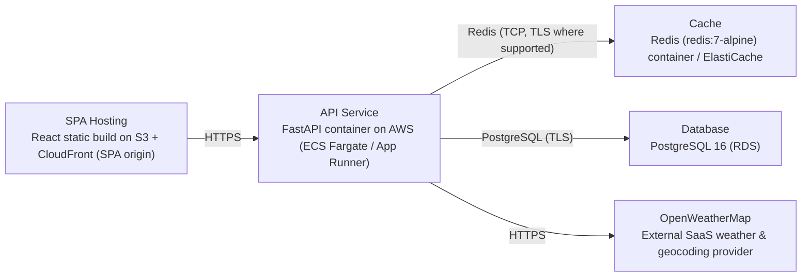

# Deployment Guide

> Maintained by QuorQ AI SDLC. Text between `sdlc:auto` markers is regenerated; anything outside them is yours and is kept.

<!-- sdlc:auto:start how-it-deploys -->
Pushes to `main` run `.github/workflows/deploy.yml`, which builds the API image (if there is a backend) and deploys the SPA to AWS Amplify. Commits touching only `docs/sdlc/**` don't deploy. Deployments can also be started from the platform's Deployment tab.
<!-- sdlc:auto:end how-it-deploys -->

<!-- sdlc:auto:start environments -->
| Name | Service | Runtime | Scaling | Environment |
|---|---|---|---|---|
| SPA Hosting | React static build on S3 + CloudFront (SPA origin) | Static assets (CDN) | CDN edge caching, scales to global demand automatically | dev |
| API Service | FastAPI container on AWS (ECS Fargate / App Runner) | Python 3.12, FastAPI 0.115 + uvicorn | Scale to near-zero when idle, scale out on traffic spikes | dev |
| Cache | Redis (redis:7-alpine) container / ElastiCache | Redis 7 | Single small node sufficient for lightweight scope | dev |
| Database | PostgreSQL 16 (RDS) | PostgreSQL 16 | Smallest instance, idle in this scope | dev |
| OpenWeatherMap | External SaaS weather & geocoding provider | HTTPS REST | Managed by provider (rate-limited) | dev |
<!-- sdlc:auto:end environments -->

<!-- sdlc:auto:start live -->
_Not deployed yet._
<!-- sdlc:auto:end live -->

<!-- sdlc:auto:start topology -->

<!-- sdlc:auto:end topology -->
